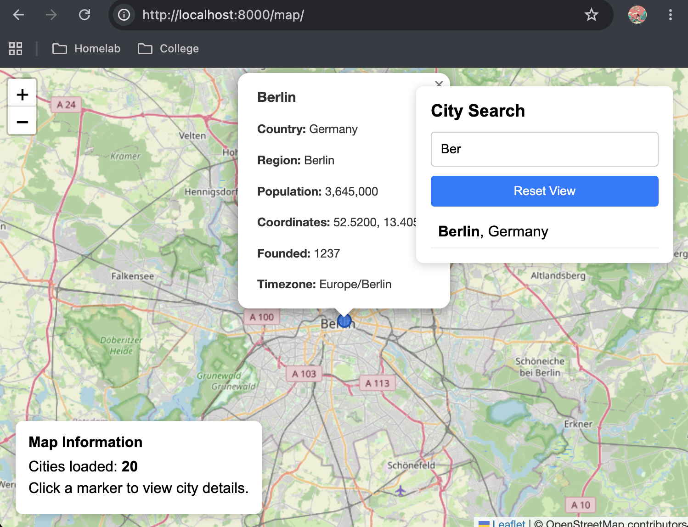

# Cities Web Mapping - Lab 4

## Interactive Leaflet Map

The application uses Leaflet.js to display the cities retrieved from the Django REST API. Users can search for cities, click markers to view information, and reset the map view.

## Tests

The Django automated tests completed successfully with 2 tests passing.
