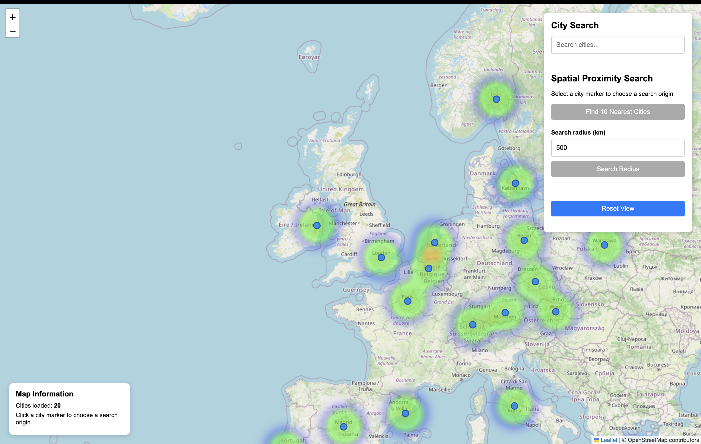
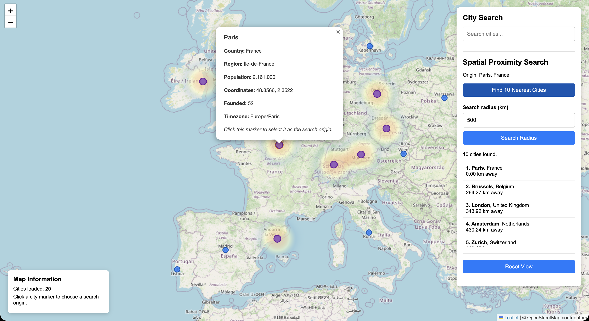
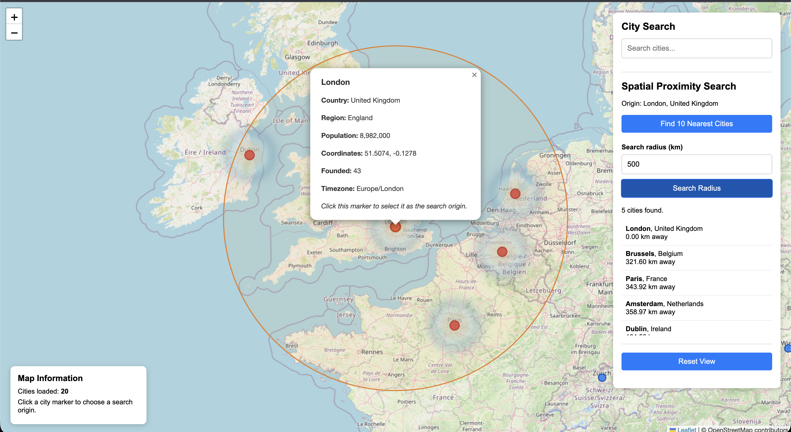
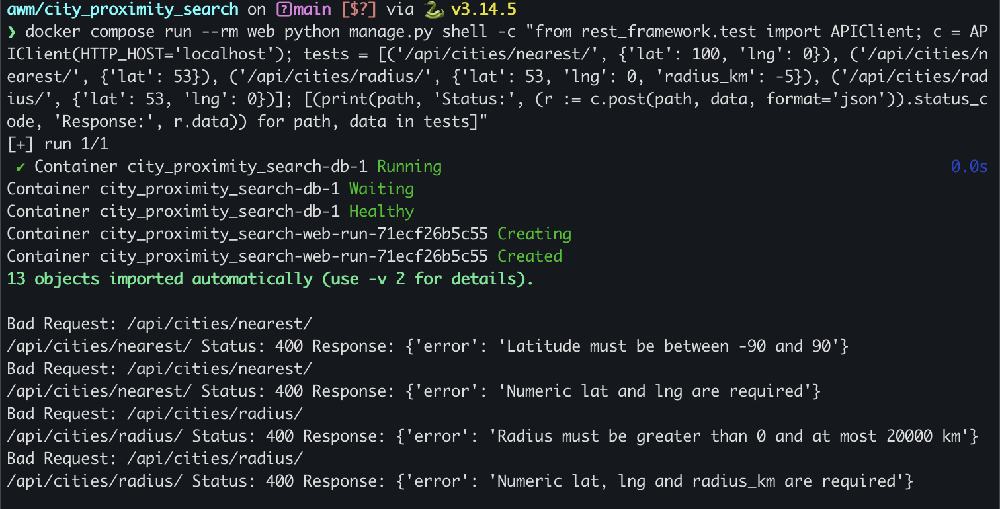
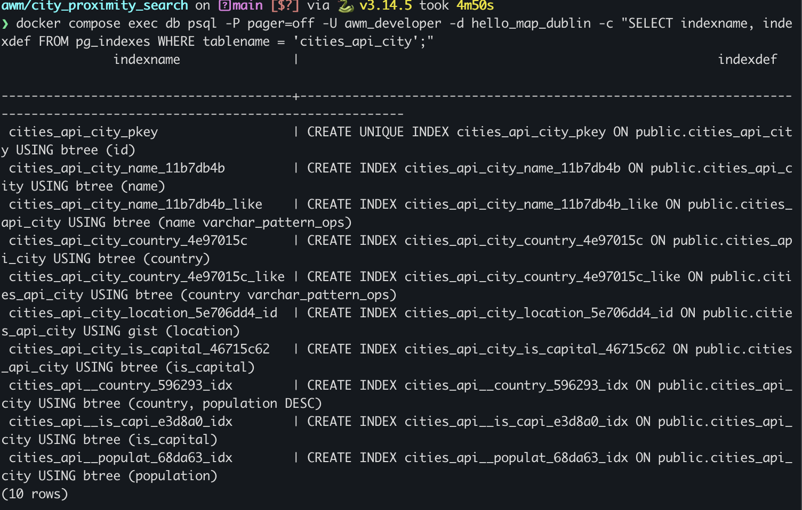

# City Proximity Search - Lab 5

## Features

- Interactive Leaflet map with OpenStreetMap tiles.
- City markers with information popups.
- Search cities by name or country.
- Select a city marker as the proximity search origin.
- Find the 10 nearest cities, ranked by distance.
- Search for cities within a specified radius.
- Display distances in kilometres.
- Visualise search results using distinct map markers.
- Display a radius circle for radius searches.
- Heatmap visualisation with different gradients for default, nearest-city, and radius searches.
- Reset the map and clear proximity search results.
- Validate coordinates and radius inputs.

### Proximity Search Map

### Nearest Cities Search

### Radius Search

### API Tests

### Spatial Index

