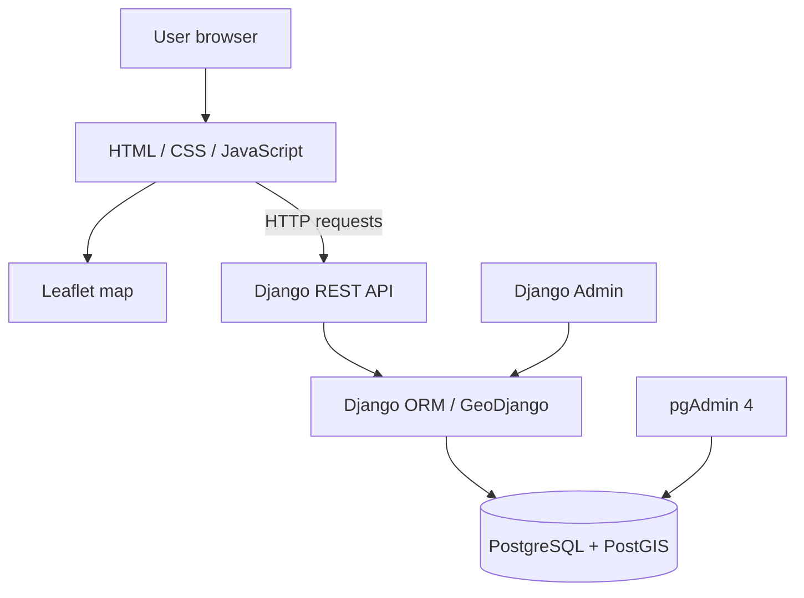
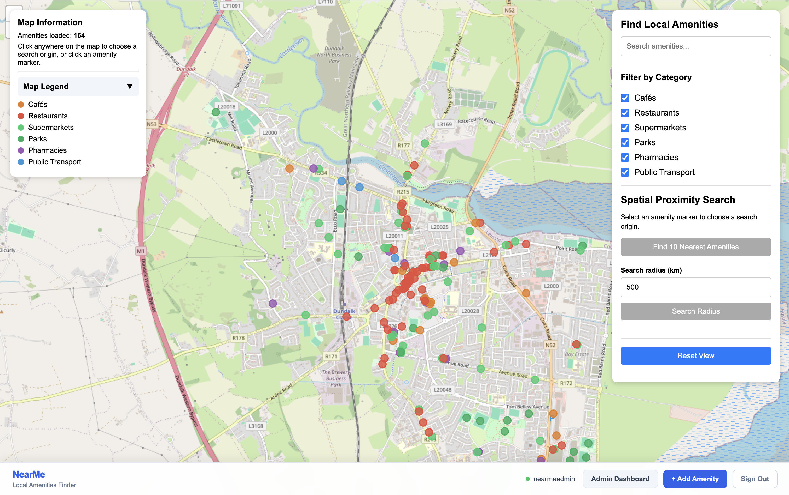
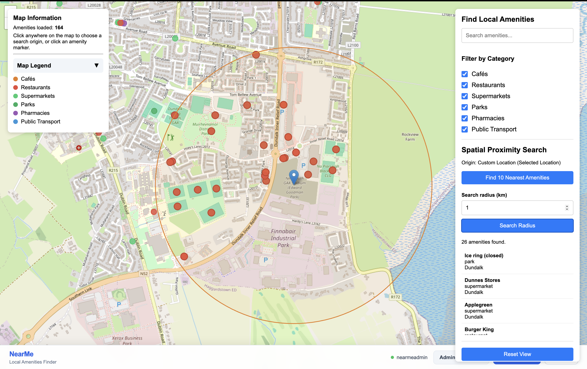
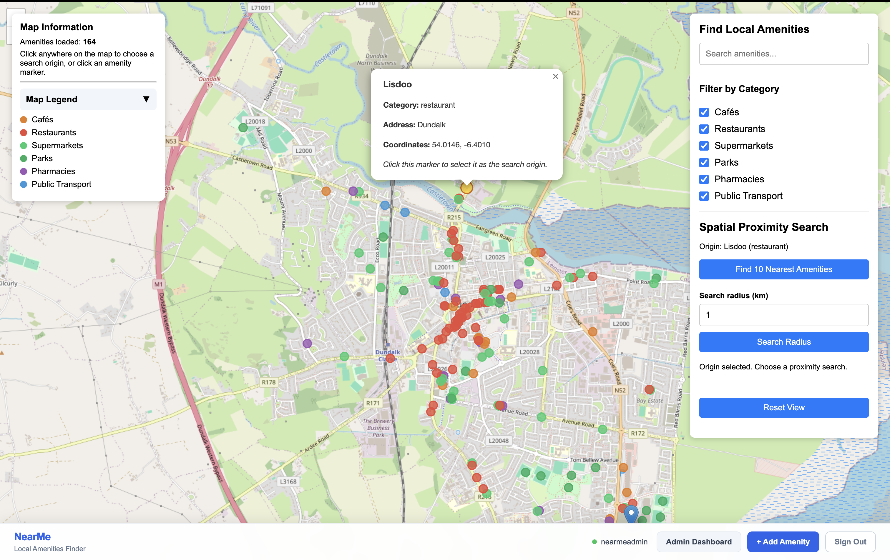
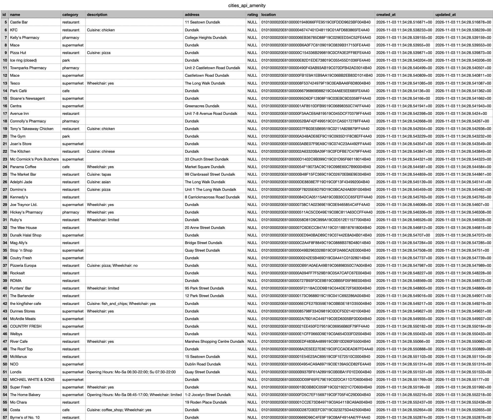

# NearMe: Local Amenities Finder

NearMe is a location-based web application for finding local amenities in Dundalk, Ireland. It displays amenity locations on an interactive map and supports category filtering and spatial searches.

## Features

- Interactive Leaflet map using OpenStreetMap tiles.
- Local amenities displayed as map markers.
- Amenity categories: cafés, restaurants, supermarkets, parks, pharmacies and public transport.
- Search and filter amenities.
- Find the 10 nearest amenities to a supplied location.
- Search for amenities within a specified radius.
- Search amenities inside a bounding box.
- GeoJSON endpoint for spatial data.
- Django Admin interface for managing amenity records.
- REST API with validation for spatial query inputs.

## Technology stack

- **Backend:** Python, Django, Django REST Framework
- **Spatial database:** PostgreSQL with PostGIS
- **Spatial framework:** GeoDjango
- **Frontend:** HTML, CSS, JavaScript
- **Map:** Leaflet with OpenStreetMap tiles
- **API documentation:** drf-spectacular / Swagger UI
- **Containerisation:** Docker Compose
- **Database management:** pgAdmin 4

## Architecture



## Data

The application uses amenity records supplied in `dundalk_amenities_import.json`. The import command stores these records in the project's PostgreSQL/PostGIS database. During normal use, the Django application queries its database rather than reading the JSON file directly.

Each amenity includes a name, category, optional description and address, optional rating, and a geographic point location (longitude and latitude, SRID 4326).

## Requirements

- Docker Desktop with Docker Compose
- Git (for cloning the repository)

## Local setup with Docker Compose

1. Clone the repository and enter the project directory:

   ```bash
   git clone <repository-url>
   cd <repository-directory>
   ```

2. Create a local environment file from the template:

   ```bash
   cp .env.example .env
   ```

3. Open `.env` and set local values for the database credentials, pgAdmin login, and Django secret key. Do not commit `.env` or real credentials.

4. Build and start the services:

   ```bash
   docker compose up --build -d
   ```

5. Apply Django migrations:

   ```bash
   docker compose exec web python manage.py migrate
   ```

6. Import the supplied amenity JSON data:

   ```bash
   docker compose exec web python manage.py import_amenities
   ```

   The import command reads `dundalk_amenities_import.json` from the project root. Run it once on a fresh database to populate the amenity table.

7. Create a Django admin account:

   ```bash
   docker compose exec web python manage.py createsuperuser
   ```

8. Open the application:

   - NearMe map: http://localhost:8000/
   - Django Admin: http://localhost:8000/admin/
   - API schema: http://localhost:8000/api/schema/
   - Swagger UI: http://localhost:8000/api/docs/
   - pgAdmin: http://localhost:5050/

To check the running containers:

```bash
docker compose ps
```

To stop the services:

```bash
docker compose down
```

To stop services and remove the database volumes (this deletes persisted database data):

```bash
docker compose down -v
```

## API endpoints

The API is available under `/api/`.

| Method | Endpoint | Description |
|---|---|---|
| GET | `/api/amenities/` | List amenities. Supports category filtering, search and ordering. |
| GET | `/api/amenities/<id>/` | Retrieve one amenity. |
| GET | `/api/amenities/geojson/` | Retrieve amenities as GeoJSON features. |
| GET | `/api/amenities/radius/?longitude=<lng>&latitude=<lat>&radius=<km>` | Find amenities within a radius, ordered by distance. |
| GET | `/api/amenities/bbox/?min_longitude=<lng>&min_latitude=<lat>&max_longitude=<lng>&max_latitude=<lat>` | Find amenities within a bounding box. |
| POST | `/api/amenities/nearest/` | Find the 10 nearest amenities. Send JSON with `lat` and `lng`. |
| POST | `/api/amenities/create/` | Create an amenity (admin permission required). |
| PUT/PATCH | `/api/amenities/<id>/update/` | Update an amenity (admin permission required). |
| DELETE | `/api/amenities/<id>/delete/` | Delete an amenity (admin permission required). |

Example nearest amenities request body:

```json
{
  "lat": 54.0,
  "lng": -6.4
}
```

The API validates coordinate and radius values and returns HTTP 400 for invalid query input. Full endpoint schemas can be explored through Swagger UI at `/api/docs/`.

## Database and spatial queries

The main custom database model is `Amenity`, defined in `cities_api/models.py`. Its `location` field is a GeoDjango `PointField` using geography storage, SRID 4326, and a spatial index.

Spatial operations implemented by the API include:

- **Proximity / radius search:** filter amenities within a distance of a supplied point and order them by distance.
- **Nearest amenities:** annotate records with distance from the supplied point, order by distance, and return the nearest 10.
- **Bounding box search:** select amenity locations within a polygon created from the supplied bounding-box coordinates.

Database migrations are located in `cities_api/migrations/`.

## Screenshots

Screenshots from the project are included in `submission_evidence/`.

## Known limitations

- The supplied amenity dataset is static; the application does not automatically refresh it from OpenStreetMap.
- Location-based results depend on the data included in the local database.
- The Docker Compose configuration is intended for local development and assessment, not production deployment.
- The project has not been configured as a production-hardened public service.

## Project structure

```text
.
├── cities_api/                 # Amenity model, serializers, API views and URLs
│   ├── migrations/             # Database migrations
│   └── management/commands/    # JSON amenity import command
├── hello_map/                  # Django project settings and root URLs
├── templates/                  # Main frontend templates
├── static/                     # CSS, JavaScript and images
├── tests/                      # Project tests
├── submission_evidence/         # Application screenshots/evidence
├── dundalk_amenities_import.json
├── Dockerfile
├── compose.yaml
├── requirements.txt
└── .env.example
```

## Screenshots

### Main Application
The NearMe Local Amenities Finder displaying amenity locations across Dundalk.



### Spatial Search
Example of a spatial search displaying nearby amenities and search results.



### Amenity Details
Example of an amenity marker selected on the map, displaying its information.



### Database
PostgreSQL/PostGIS database showing the stored amenity records in pgAdmin.



## License and attribution

This project was developed for the Location-Based Services assignment at Technological University Dublin. It uses Django, PostgreSQL/PostGIS, Leaflet and OpenStreetMap. Review the relevant licenses and attribution requirements for third-party software and map data before redistributing or deploying the application.
